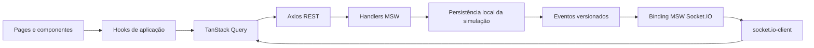

# Arquitetura

## Visão geral

Aplicação React e TypeScript organizada por responsabilidade, com APIs simuladas na rede pelo MSW. O mesmo conjunto de handlers e fixtures atende desenvolvimento, build de demonstração e testes. Componentes e hooks consomem a API pelo Axios; não importam fixtures nem substituem operações de negócio por setters locais.

## Organização

| Diretório        | Responsabilidade                                                                       |
| ---------------- | -------------------------------------------------------------------------------------- |
| `src/app`        | Providers, Router, política global de Query e bootstrap da UI                          |
| `src/pages`      | Composição das telas e estado de apresentação                                          |
| `src/components` | Elementos compartilhados e componentes acessíveis; Button adaptado do padrão shadcn/ui |
| `src/hooks`      | Consultas e mutations de carrinho, favoritos e carteiras                               |
| `src/api`        | Contratos de transporte, consultas Axios e normalização de erros                       |
| `src/domain`     | Schemas Zod, tipos e invariantes de conta, checkout e eventos                          |
| `src/auth`       | Proteção de rotas, sincronização/geração de sessão e destinos da autenticação          |
| `src/realtime`   | Cliente Socket.IO, listeners e reconciliação                                           |
| `src/mocks`      | Handlers REST/WebSocket, fixtures, banco e simulação de falhas                         |
| `src/lib`        | Precisão ETH e armazenamento de rascunhos/tentativas                                   |
| `src/styles`     | Ajustes da composição visual sobre os tokens e estilos de base                         |

## Rotas e estado remoto

TanStack Router gerencia URLs, parâmetros, histórico e guards das rotas privadas. Busca, coleção, rede, preço, ordenação, aba e página compõem a URL. Alterar filtros reinicia a paginação. A chave da consulta inclui os parâmetros normalizados; AbortSignal é encaminhado ao Axios e respostas obsoletas são canceladas/descartadas.

O sucesso do login retoma um destino interno validado. Cancelar retorna à última página pública; após refresh do login, usa uma alternativa pública segura, incluindo o carrinho quando o destino era pagamento. Destinos externos, caracteres de controle e ciclos de autenticação são rejeitados.

TanStack Query mantém os dados remotos. Estado local de React fica restrito a apresentação, formulários, seleção de edição, quantidade e revisão de compra.

| Recurso                        | Cache e sincronização                                                                                                   |
| ------------------------------ | ----------------------------------------------------------------------------------------------------------------------- |
| Catálogo e detalhe             | `staleTime` de 30 s; parâmetros/ID nas chaves; uma nova tentativa para consultas transitórias, nenhuma para detalhe 404 |
| Sessão                         | 30 s; consulta após refresh/foco; sem retry automático; tratamento distinto de sessão anônima e falha de transporte     |
| Carrinho                       | Identidade de usuário/visitante na chave; `staleTime: 0`; mutations serializadas por identidade                         |
| Favoritos, carteiras e pedidos | Chaves privadas incluem usuário; invalidação após mutations/eventos                                                     |
| Mutations                      | Sem retry automático; pedido só é reenviado com chave e conteúdo da mesma tentativa                                     |
| Pedido pendente                | Eventos Socket.IO e polling de recuperação de 1 s                                                                       |

Favoritos têm atualização otimista por item, snapshot anterior e rollback de falha. A reconciliação ocorre após a última mutation concorrente daquele usuário. O cache privado, as mutations e as subscriptions são descartados no logout/troca de conta. Uma geração de sessão impede que respostas antigas atualizem outra conta.

## Contratos, persistência e sessão

Os [contratos REST e eventos](docs/CONTRATOS.md) são tipados e compartilham schemas de validação entre formulários e handlers. Erros incluem código, mensagem e campos; conflitos e permissões continuam sendo decididos na API, mesmo após validação no cliente.

`kurio:db:v1` mantém catálogo, contas, sessões, favoritos, carrinhos, carteiras, conexões, pedidos, idempotência e eventos no localStorage. Migrações acrescentam campos sem apagar dados anteriores. Uma fila por instância coordena gravações; eventos são emitidos pelos sockets da instância que realizou a operação. Esse banco não oferece transações distribuídas nem sincronização multiusuário em servidor.

A sessão usa identificadores opacos em cookies, expira em 30 minutos e é validada nos handlers. Senhas fictícias usam PBKDF2/SHA-256 com 120.000 iterações, salts aleatórios e sem armazenamento em claro. Alteração de senha invalida as sessões. Hashes não são expostos na API.

Os cookies do mock são legíveis por JavaScript e o banco local pode ser inspecionado pelo proprietário do navegador. A implementação demonstra o contrato de autenticação e isolamento, sem representar segurança de backend de produção. O reset restaura integralmente as fixtures, inclusive cookies, tentativas e rascunhos.

## Carrinho, cotação e compra

A API deriva o proprietário dos cookies. O login combina itens do visitante com os da conta por NFT/edição, limita quantidades ao estoque e informa ajustes. Logout não converte o carrinho privado em carrinho visitante.

ETH trafega como string decimal e é convertido para BigInt em wei. Subtotal, descontos, taxa e total vêm da cotação da API. O cupom inicial `KURIO10` aplica 10%, truncado em wei; a taxa fictícia é 0.005 ETH por rede distinta. O token da cotação incorpora regras de preço, revisão do carrinho, versões dos NFTs e quantidades.

Conectar carteira, revisar e confirmar são operações distintas. Trocar carteira, rede, provedor ou dados invalida a revisão. A API confere conexão, carteira/versão, estoque, cupom e cotação antes de criar o pedido.

A tentativa persiste UUID e payload **antes** do POST. A chave idempotente é associada ao usuário e ao conteúdo normalizado: repetir recupera o mesmo pedido; conteúdo diferente gera 409. Existe no máximo um pedido pendente por usuário. Um timeout consulta a mesma tentativa antes de permitir reenvio.

Pedidos reservam estoque e guardam snapshot independente dos itens, preços, descontos, taxas, carteira e cliente. `pending` pode avançar para `confirmed` ou `declined`; estados terminais não regridem. Confirmação remove apenas as quantidades compradas do carrinho atual. Recusa devolve o estoque e preserva itens. Recibo, referência de transação e explorador só aparecem após confirmação da API.

O timeout de criação de 700 ms torna reproduzível o cenário em que o mock salva o pedido e retarda a resposta em 1.500 ms. Essa latência é uma configuração de teste da demonstração. Timers, consultas e reconexão concluem pedidos vencidos após refresh.

## Socket.IO e reconexão

O cliente real `socket.io-client` usa WebSocket em `/realtime`, interceptado por `@mswjs/socket.io-binding`. O mock implementa handshake/heartbeat Engine.IO e inscrição privada validada pela sessão. Não simula namespaces, salas ou fallback HTTP polling completos.

Eventos `nft.updated`, `quote.updated` e `order.updated` incluem ID, recurso, sequência e versão. O cliente valida payloads, descarta duplicatas/versões antigas, confere titular e geração de sessão e invalida os recursos REST afetados. Listeners são liberados no unmount/logout. Eventos não atualizam estado da UI por callbacks alternativos ao socket.

A reconexão reconcilia recursos REST ativos, cobrindo eventos perdidos. O cenário de preço/estoque atualizado informa a mudança no carrinho e bloqueia confirmação com cotação antiga. Pedido pendente é recuperável após desconexão ou refresh com a mesma identificação.

## Carregamento e recuperação de erros

O bootstrap apresenta um shell, baixa UI e mocks em paralelo e aguarda `worker.start()` antes de montar componentes ou capturar WebSocket no Engine.IO. Catálogo, sessão e carrinho estão disponíveis desde o início; resolvers de operações privadas e rotas privadas são carregados sob demanda. Consultas públicas são antecipadas no mesmo QueryClient.

Ao retornar a uma aba, consultas desatualizadas são revalidadas. O navegador pode encerrar o processo do service worker sem remover seu registro. No MSW 2.15, isso apaga a lista de clientes ativos mantida em memória; uma consulta pode escapar da interceptação e chegar à hospedagem estática, que retorna 404 para `/api/session`. Essa falha foi reproduzida encerrando o worker pelo Chromium DevTools Protocol, inclusive como visitante.

`src/mocks/worker-lifecycle.ts` confirma o handshake `MOCK_ACTIVATE` / `MOCKING_ENABLED` antes das chamadas HTTP. O bootstrap instala essa preparação no cliente Axios somente quando os mocks estão ativos. Requisições concorrentes compartilham a mesma confirmação em andamento; o listener é removido no sucesso/erro e a espera tem limite de cinco segundos. A geração de sessão é capturada antes da espera: uma troca de conta cancela o envio que ficou aguardando.

A preparação não cria respostas de negócio, não altera o arquivo distribuído `mockServiceWorker.js`, não encerra o Socket.IO e não reenvia mutations. O protocolo está isolado na camada de mocks e coberto por testes de encerramento real do worker; atualizações do MSW devem preservar essa verificação. Repetir apenas `worker.start()` enquanto a biblioteca se considera iniciada não reativa o cliente.

O transporte também rejeita respostas 200 que não sejam JSON, preservando 204 para operações sem corpo. Um fallback HTML da hospedagem não entra no cache como se fosse sessão ou carrinho válido; a consulta apresenta seu estado recuperável de erro.

Falhas REST permitem nova consulta pelo botão de recuperação. O visitante recebe uma mensagem de verificação de acesso, sem pressupor que tenha feito login; uma sessão realmente expirada continua exigindo autenticação. Erro fatal de rota recarrega o documento para descartar uma importação React.lazy rejeitada. Rascunhos e tentativas já persistidos sobrevivem.

## Interface, UX e acessibilidade

Tokens, tipografia local, componentes compartilhados e estilos responsivos seguem os frames fornecidos. Tailwind participa dos utilitários e da composição; Button usa Radix Slot, CVA e tailwind-merge no padrão shadcn/ui. Diálogos/drawers têm controle de foco, labels, mensagens associadas e operação por teclado. Abas suportam setas, Home e End. Skeletons reservam espaço e respeitam movimento reduzido.

Os [desvios visuais](docs/DESIGN.md) incluem fonte IBM Plex Mono aproximada, ícones locais, ampliação dos quatro retratos de 250 px e dados dinâmicos diferentes dos exemplos estáticos. O X do mobile tem área de toque de 44 px. Conexão, revisão e confirmação permanecem explícitas; dados do colecionador e resumo são expansíveis no mobile, tornando o fluxo mais alto que o frame estático.

Ações auxiliares fora do escopo, como OAuth e newsletter, explicam a limitação sem aparentar sucesso. Não há blockchain, extensão de carteira, gateway, e-mail real ou armazenamento remoto. Galeria oferece composições CSS da mesma imagem original. Limitações de origem, resolução e compressão estão em [ASSETS.md](docs/ASSETS.md).

## Performance e verificação

Fontes e imagens são locais. `<picture>` oferece AVIF/WebP/PNG com dimensões explícitas; preload antecipa retrato/fontes relevantes. AVIF usa compressão com perda declarada e WebP é comparado aos pixels originais. Não existe versão exclusiva da aplicação para Lighthouse.

O [container da CI](ci/README.md) fixa Node, distribuição e Chromium. Validação e Lighthouse são jobs independentes. Playwright cobre os fluxos, falhas, isolamento e 12 baselines em 390/768/1440 px. Cada contexto de browser parte de estado isolado. Lighthouse executa três medições por página/perfil, verifica dados/assets carregados e falha quando uma meta não é atendida.

Configuração, versões, LCP, CLS, TBT, relatórios e hashes do build estão em [PERFORMANCE.md](docs/PERFORMANCE.md) e [VALIDACAO.md](docs/VALIDACAO.md). A configuração de hospedagem suporta acesso direto/refresh das rotas e mantém MSW ativo no build público.
