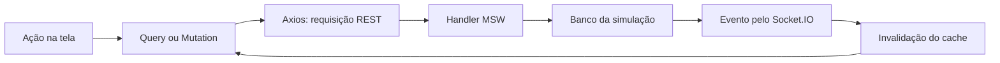

# Etapa 5 — transformar o layout em uma interface verificável

## O que mudou e por quê

As telas de conta e compra já funcionavam. Com os 13 frames recebidos, passamos a comparar sua composição com o design: o mesmo dado da API ganhou a apresentação adequada para desktop e mobile. Também incluímos os campos visíveis no layout, como nome de usuário, ENS, apelido de carteira e provedor.

Uma mudança visual pode afetar comportamento. Por exemplo, abrir a busca pelo ícone não pode apagar os filtros da URL; trocar o provedor da carteira exige nova conexão e nova revisão. Os testes verificam esses contratos enquanto a aparência evolui.

## Leia o código nesta ordem

1. `src/components/market-header.tsx`: um cabeçalho reutilizado evita que navegação e saída da conta funcionem de formas diferentes entre telas.
2. `src/pages/profile.tsx` e `src/domain/account.ts`: o formulário usa um schema para validar e associar erros aos campos. Ao salvar, envia os dados pela API e aguarda a resposta; atualizar a página demonstra a persistência.
3. `src/pages/nft-detail.tsx`: a galeria usa o retrato original, o diálogo controla foco e as abas também funcionam com teclado. Edição, preço e disponibilidade continuam vindo da consulta.
4. `src/pages/checkout.tsx`: carteira, rede e provedor participam da revisão. Uma alteração invalida a confirmação anterior. O snapshot preservado pelo pedido permite que o recibo continue correto mesmo depois de mudar o catálogo.
5. `tests/e2e/design-interactions.spec.ts`: os testes executam essas ações pelo navegador e observam a interface e o resultado da API.

**Componente** é uma parte reutilizável da interface. **Schema** descreve os dados aceitos. **Query** busca dados remotos. **Mutation** pede uma alteração. **Snapshot** é a cópia dos dados da compra no momento do pedido. Saber explicar esse percurso é mais útil que decorar os nomes das bibliotecas.

## A viagem de uma alteração

A resposta HTTP informa o resultado da operação; o evento avisa que um recurso mudou e provoca uma nova consulta. O componente não altera diretamente o banco nem recebe um evento por uma função de teste.

## Por que o skeleton precisa ter tamanho parecido

Skeleton é o espaço provisório mostrado enquanto os dados carregam. Uma margem que colapsava no detalhe movia a página quando o skeleton era substituído. Reservar a composição da galeria e da coluna de informações, além de impedir esse colapso, estabilizou a posição do conteúdo.

O teste de carregamento lento mede a posição do conteúdo antes e depois. O Lighthouse mede CLS, que registra deslocamentos visuais durante o carregamento. Consulte `PERFORMANCE.md` para as medições reais e suas limitações.

## O que cada verificação responde

| Verificação       | Pergunta                                                 |
| ----------------- | -------------------------------------------------------- |
| TypeScript        | Os tipos e contratos encaixam?                           |
| Lint e formatação | Há problemas estáticos ou inconsistência de escrita?     |
| Unitários         | Cálculos ETH e validações isoladas mantêm suas regras?   |
| E2E               | O usuário consegue executar os fluxos, incluindo falhas? |
| Screenshot        | A interface mudou em relação à baseline revisada?        |
| Lighthouse        | Como a página carregou nas condições medidas?            |
| Deploy público    | A versão entregue funciona fora do ambiente local?       |

Nenhuma dessas verificações substitui todas as outras. Uma captura bonita não comprova uma compra; um teste funcional não comprova igualdade com o Figma.

## Exercício guiado de 15 minutos

1. Abra um NFT, amplie a arte, pressione Escape e observe o foco voltar ao botão.
2. Nas abas, use Tab e as setas. Identifique o painel que mudou.
3. No perfil, digite espaço no nome de usuário e salve. Leia o erro; corrija e salve novamente. Atualize a página e confira o valor.
4. Adicione um NFT ao carrinho. Digite outra quantidade e pressione Enter; compare subtotal e taxa.
5. No pagamento, conecte e revise; mude o provedor e observe a exigência de reconexão e revisão.
6. Faça uma compra simulada e atualize o recibo. Explique por que ele usa o snapshot do pedido.
7. Execute um teste e abra o relatório. Conte o que foi observado e o que esse teste não comprova.

Use apenas dados fictícios. As contas de demonstração já existem, mas um e-mail novo deve passar por cadastro antes do login.

A próxima etapa externa é publicar e validar a URL seguindo `DEPLOY.md`. O treino de apresentação permanece para depois dessa validação, usando o código e as evidências que você estudou.
